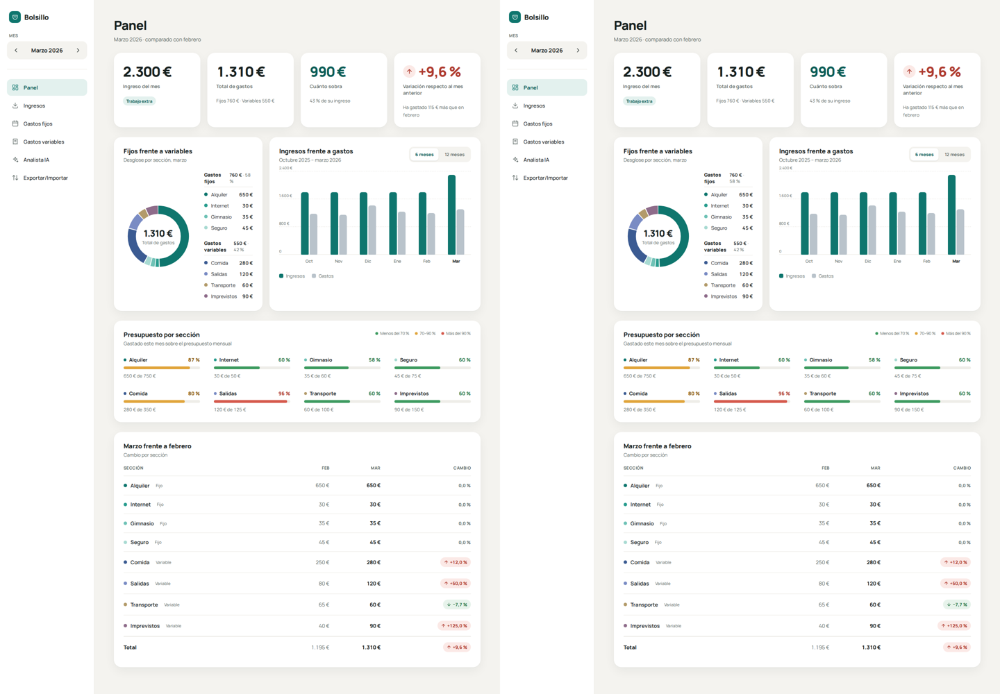

# Bolsillo

Organizador de gastos personales con analista de IA. Trabajo final del curso de *vibe coding*: un MVP desarrollado dirigiendo a un agente de IA.

**Aplicación desplegada:** *(enlace de Render pendiente de añadir)*



## Qué problema resuelve

Mucha gente no sabe en qué gasta su dinero ni por qué un mes gasta más que otro, y las aplicaciones de finanzas le resultan rígidas o complicadas. Bolsillo permite apuntar ingresos y gastos en segundos y ver al instante cuánto se gasta, cuánto sobra y qué ha cambiado respecto al mes anterior.

## Funcionalidades

- **Ingresos:** varios por mes, con un motivo opcional (extra, baja o vacaciones).
- **Gastos fijos:** secciones como Alquiler o Internet, con importe, presupuesto y color. Si un importe cambia, el cambio vale de ese mes en adelante y los meses anteriores no se alteran.
- **Gastos variables:** registro rápido por fecha, sección, monto y nota; creación, edición y borrado de secciones.
- **Panel:** cuatro tarjetas de resumen, gráfico de fijos frente a variables, barras de ingresos y gastos de 6 o 12 meses, medidores de presupuesto (verde, ámbar y rojo) y tabla comparativa con el mes anterior. Se actualiza al instante.
- **Analista IA:** resume el mes en tres observaciones y responde preguntas. Solo interpreta las cifras ya calculadas: no hace cuentas ni modifica datos.
- **Exportar/Importar:** descarga los datos como archivo y los vuelve a cargar, con comprobación del archivo antes de aceptarlo.
- Versión de escritorio y versión móvil.

## Stack

| Parte | Tecnología | Qué hace |
|---|---|---|
| Interfaz | HTML, CSS y JavaScript sin librerías | Pantallas, formularios y **todos los cálculos**. |
| Datos | `localStorage` del navegador | Cada visitante guarda los suyos; nunca llegan al servidor. |
| Servidor | Python con FastAPI y uvicorn | Sirve las páginas, guarda la clave de Groq y expone el analista. |
| IA | Groq, modelo `openai/gpt-oss-120b` | Interpreta el resumen que le envía el navegador. |
| Despliegue | Render (plan gratuito) | Publica la aplicación. |

Desarrollado con Claude Design y Claude (modelo Claude Opus 5.5).

## Decisiones de arquitectura

- **Los cálculos se hacen en el navegador** (`static/js/calculos.js`). El servidor no calcula ni almacena datos de usuarios.
- **La clave de Groq vive solo en el servidor**, en `.env` (fuera de Git) o en las variables de entorno de Render. Nunca llega al navegador.
- **La IA no hace cuentas.** Recibe las cifras ya calculadas y escritas («1.200 €»). Si se le pide un cálculo que no está en el resumen, responde: «Esta es una versión MVP: analizo solo los datos ya calculados en su panel. Los cálculos adicionales aún no están disponibles.»
- **Límite de 20 consultas al analista por visitante y día**, identificado por IP.

## Cómo ejecutarlo en local

Requisitos: Python 3.14 y una clave de API de Groq (gratuita en console.groq.com). Comandos para Windows PowerShell:

```powershell
git clone https://github.com/manu2306/Bolsillo.git
Set-Location Bolsillo
python -m venv .venv
.\.venv\Scripts\Activate.ps1
pip install -r requirements.txt
Copy-Item .env.example .env
```

Abra `.env` y escriba su clave detrás de `GROQ_API_KEY=`. Después:

```powershell
uvicorn main:app --reload
```

La aplicación queda en http://127.0.0.1:8000. Todo funciona sin clave salvo el Analista IA.

**Para probarla con datos:** en *Exportar/Importar*, pulse *Cargar archivo* y elija `ejemplo/bolsillo-datos-ejemplo.json`. Contiene un año de datos, de noviembre de 2025 a octubre de 2026.

## Limitaciones del MVP

- **El servidor de Render se duerme** tras 15 minutos sin visitas. La primera visita lo despierta y puede tardar hasta un minuto; la pantalla del analista avisa mientras tanto.
- **El contador de consultas está en memoria:** se reinicia cuando el servidor se duerme.
- **Los datos viven en cada navegador:** no se comparten entre dispositivos. Para moverlos está *Exportar/Importar*.
- No hay cuentas de usuario ni conexión con bancos.

## Estructura del proyecto

| Ruta | Qué contiene |
|---|---|
| `main.py` | El servidor: sirve las páginas y expone `/api/salud` y `/api/analista`. |
| `static/` | La aplicación: las 6 páginas HTML y las fuentes. |
| `static/js/datos.js` | Guardar y leer los datos en `localStorage`. |
| `static/js/calculos.js` | Todas las cuentas. |
| `static/js/comun.js` | Formatos, selector de mes y diálogo de confirmación. |
| `static/js/` (resto) | Un archivo por pantalla: `panel.js`, `ingresos.js`, `gastos-fijos.js`, `gastos-variables.js`, `analista.js` y `exportar.js`. |
| `diseno/` | Las 17 pantallas del diseño original, como referencia. |
| `ejemplo/` | Datos de ejemplo para la demostración. |
| `docs/capturas/` | Capturas de las pruebas. |
| `requirements.txt` | Librerías de Python que necesita el servidor. |
| `.env.example` | Plantilla del archivo de configuración, sin la clave. |

## Documentación del proceso

- [`PROMPT-LOG.md`](PROMPT-LOG.md): los prompts iniciales y la memoria de las sesiones con la IA.
- [`INFORME.md`](INFORME.md): informe de reflexión (qué hizo la IA, qué hice yo, errores y cómo se detectaron).
